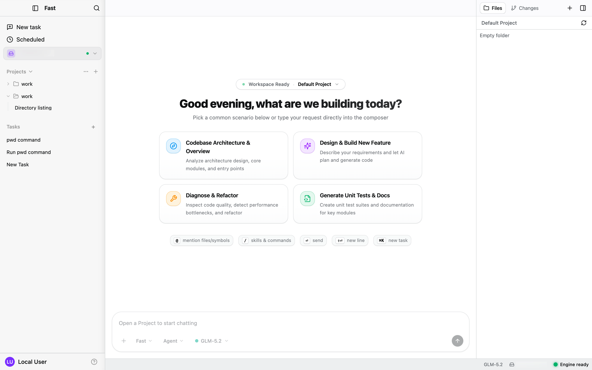
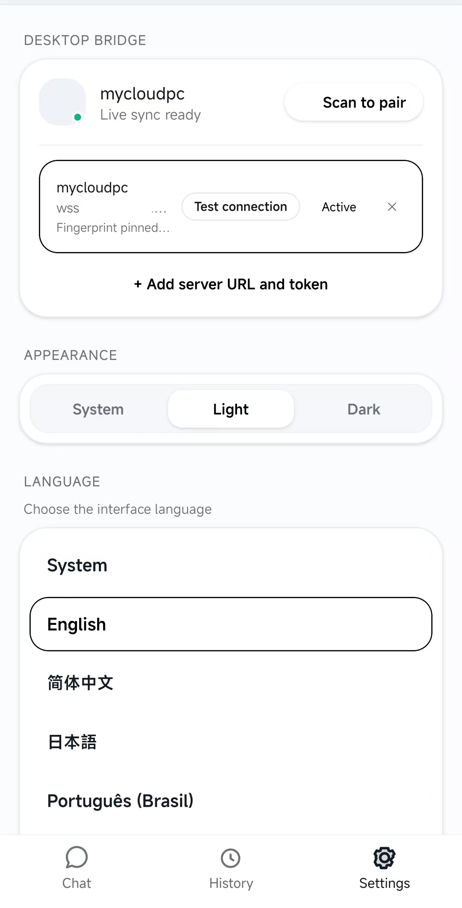
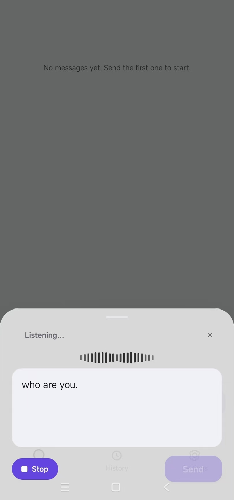
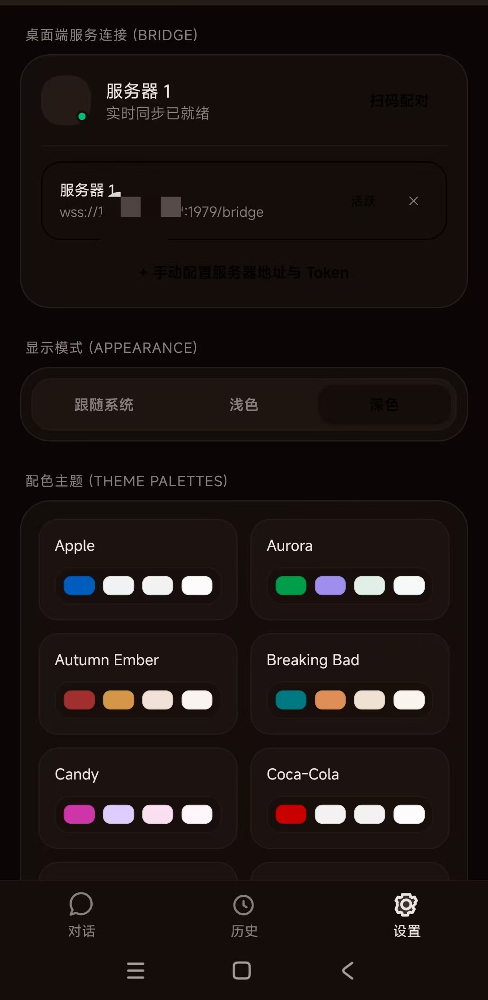
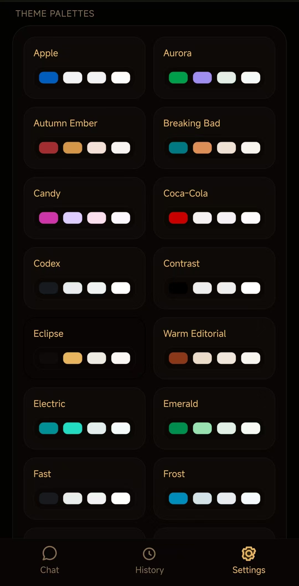
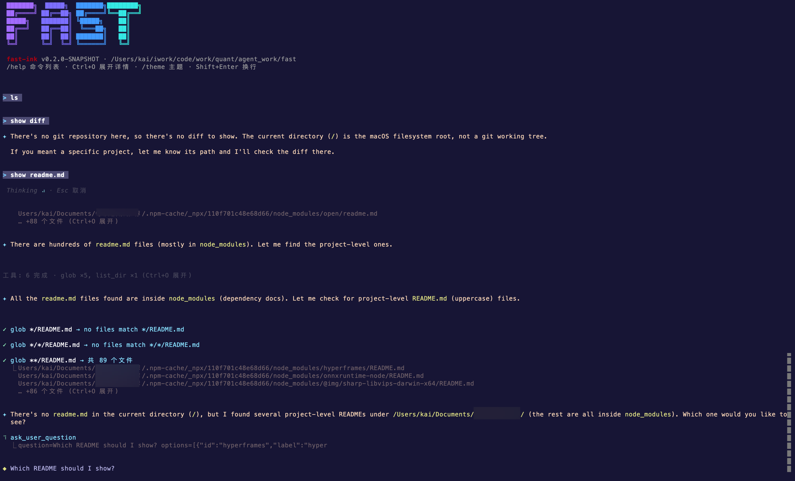

<div align="center">
  
  <h1>Fast Agent</h1>
  <p><strong>The Open-Source Muse, Cue, Grok Bot & Dots Companion with an Orchestrated Fleet of Coding Assistants.</strong></p>

  <p>
    <a href="https://github.com/kai2002/fast-agent/releases"></a>
    <a href="LICENSE"></a>
    
    <a href="https://discord.gg/HXeK9QV57"></a>
  </p>

  <p>
    <a href="README.md">English</a> | <a href="README.zh-CN.md">简体中文</a>
  </p>
</div>

---

**Fast Agent** reimagines personal AI assistance and software engineering. It combines the seamless, proactive companion experience of **Muse / Cue**, the raw speed and direct action of **Grok Bot**, the ambient, always-on intelligence of **Dots**, and a full **multi-agent orchestration engine** that lets you command an entire fleet of specialized AI engineers right from your desktop, terminal, or phone.

> [!IMPORTANT]
> Fast Agent is **under active development**. The local engine directly interacts with your workspace and runs approved shell tasks. Review all approvals and enjoy the bleeding edge!

---

## 📖 Table of Contents

- [Highlights](#-highlights-why-fast-agent)
- [See It in Action](#-see-it-in-action)
- [Quick Start](#-quick-start-30-seconds-to-launch)
- [Developer & Contributor Guide](#️-developer--contributor-guide)
- [Community & Support](#-community--support)
- [License & Security](#-license--security)

---

## 🚀 Highlights: Why Fast Agent?

### 1. 👥 Command a Fleet of AI Assistants (Multi-Agent Orchestration)
No single AI can master every domain. Fast Agent lets you recruit, organize, and orchestrate specialized AI roles:
- **Team Leadership**: Spin up an architect, coder, tester, and reviewer in a single workspace.
- **Autonomous Collaboration**: Agents plan, delegate sub-goals, run checks, and critique each other's deliverables.
- **Cluster-Aware Workspaces**: Register remote hosts as cluster nodes and route sessions to the machine that owns the code, so a fleet can span more than one box.

### 2. 💻 Coding as a First-Class Citizen
Not just chat answers or code snippets in markdown — Fast Agent lives inside the loop:
- **Inspect, Edit, & Land**: Reads repos, plans diffs, applies precise syntax edits, and verifies builds.
- **Enterprise-Grade Safety**: Full visual diff inspection, reviewable checkpoint ledger, and one-click rollback.
- **Self-Verifying Loop**: Runs tests, catches compiler errors, and iterates until tasks pass acceptance criteria.

### 3. 📱 Anywhere Companion (Desktop, Mobile, & TUI)
- **Workstation Powerhouse**: A full-featured desktop workbench with diff viewers, file explorer, session tabs, and agent graph tracking.
- **Mobile Remote Controller**: On the go? Control your desktop or cloud engine right from your phone. Assign complex coding goals, monitor terminal live logs, and approve pull-requests anywhere.
- **Hacker-Friendly TUI**: Ultra-responsive, low-latency command-line interface for SSH and minimalists.

### 4. 🔌 Pluggable Multi-Engine Runtime
Switch engines per session on the fly. Fast Agent ships with its high-performance native engine, and can attach third-party backends such as **DeepSeek DSH** through the extension layer.

---

## 📸 See It in Action

<div align="center">
  <h3>Desktop Workbench — Multi-Agent Collaboration & Visual Diff Review</h3>
  
</div>

<br/>

<div align="center">
  <h3>Mobile Companion — Remote Command, Live Streams & One-Tap Approval</h3>
  <p align="center">
    
    
    
    
  </p>
</div>

<br/>

<div align="center">
  <h3>TUI Terminal — Blazing Fast, Pure Unix Bridge</h3>
  
</div>

---

## ⚡ Quick Start: 30 Seconds to Launch

### 1. Download Pre-built Apps

Get ready-to-run releases from [GitHub Releases](https://github.com/kai2002/fast-agent/releases):

| Platform | Package | How to Install |
| :--- | :--- | :--- |
| **macOS (Apple Silicon)** | `Fast-*-mac-arm64.dmg` | Open DMG → Run `Install Fast.pkg` |
| **macOS (Intel)** | `Fast-*-mac-x64.dmg` | Open DMG → Run `Install Fast.pkg` |
| **Android** | `fast-mobile-*.apk` | Install APK on phone → Pair with desktop |
| **Linux (x64 / arm64)** | `Fast-*-linux-*.AppImage` | `chmod +x *.AppImage` and run (glibc) |
| **Windows (x64)** | `Fast-*-win-x64.exe` | Run NSIS installer *(In active development)* |

### 2. Pair Your Mobile Companion in 2 Steps

1. **Open Desktop App**: Navigate to `Settings` → `Servers` → Turn on **Mobile pairing**.
2. **Scan from Phone**: Open the Fast Mobile companion, tap **Scan to pair**, and point at the QR code.
3. *Remote or on cellular?* Switch to the **Cloudflare Tunnel** tab on Desktop to generate a secure zero-config public link and pair from anywhere without public IPs or port forwarding! *(Experimental — see [SECURITY.md](SECURITY.md) for the trust model.)*

> [!WARNING]
> The pairing token is a credential. Never paste it into issues, screenshots, or chat. Treat a lost phone as a leaked secret: rotate the desktop token and drop the pair.

---

## 🛠️ Developer & Contributor Guide

Fast Agent is built with a modular monorepo: TypeScript/React frontend, Electron/Expo clients, and a high-throughput multi-agent engine kernel.

### Repository Architecture

```text
fast/
  apps/desktop          Electron desktop app (Renderer + Bridge IPC)
  apps/tui              fast-cli interactive terminal client
  apps/mobile           Expo React Native companion (Android / iOS)
  packages/core         Headless layer: bridge/protocol, bridge/client, session-view, i18n
  packages/web/ui       Shared React design system (desktop only)
  modules/engine        High-performance agent engine & bundled JRE
  extensions/           Pluggable engine plugins (e.g., DeepSeek DSH)
```

Full layout and layer rules: [doc/structure.md](doc/structure.md).

### Environment Requirements

| Requirement | Version | Note |
| :--- | :--- | :--- |
| **Node.js** | 20.19+ or 22 | Runtime for apps & packages |
| **pnpm** | 9 | Package manager |
| **JDK** | 17+ | Only required on builder machine running `fetch-engine` |
| **Maven** | 3.x | Only needed if building engine extensions |

Official hosts are **macOS** and **glibc Linux**. Alpine / musl is not supported, and native Windows is not a daily-dev path. Linux also needs a compiler toolchain for `node-pty` (`build-essential`), GTK/NSS for Electron, and `lsof` / `procps`.

### Where to Change It

| If you are changing… | Touch |
| :--- | :--- |
| NDJSON / IPC / daemon attach | `packages/core/bridge` |
| Transcript / approval view model | `packages/core/session-view` |
| Copy | `packages/core/i18n` (run `pnpm check:i18n`) |
| Shared React controls | `packages/web/ui` — desktop only; mobile and TUI must not import this |
| Electron host | `apps/desktop` |
| Terminal UI | `apps/tui` |
| Phone companion | `apps/mobile` |
| Dev / pack entry | `dev/*.sh`, `build/*.sh`, `scripts/` |

### Development Workflow

```bash
# 1. Clone repository & install dependencies
git clone https://github.com/kai2002/fast-agent.git
cd fast-agent
pnpm install

# 2. Fetch the pre-built engine binary (incremental, host OS)
pnpm fetch-engine

# 3. Start developing your target surface
pnpm dev:desktop       # Run Desktop Electron app
pnpm dev:tui           # Run TUI terminal app
pnpm dev:mobile        # Run Mobile client (Expo / Metro)
```

pnpm swallows extra script arguments, so flags go after `--`.

#### `pnpm fetch-engine`

```bash
pnpm fetch-engine -- --clean
pnpm fetch-engine -- --os darwin-arm64
pnpm fetch-engine -- --help
```

| Flag | Effect |
| :--- | :--- |
| `--incremental` | Default. Skip Maven when `modules/engine/current/bin/fast-cli` exists. Still ensures the Temurin 17 JRE under `current/jre/` |
| `--clean` | `mvn clean package`, then rewrite `current/` and the JRE. Refresh the engine or switch OS with this |
| `--os <os>` | Target OS. Same as a positional `os`: `darwin-arm64`, `darwin-x64`, `linux-x64`, `linux-arm64`, `win32-x64`, `all` |
| `-h`, `--help` | Print usage |

No flags means an incremental fetch for the host OS. Incremental mode does not compare the OS already stamped in `current/`; a tree built for another OS needs `--clean`.

#### `pnpm dev:desktop`

`pnpm dev:desktop:mock` is `./dev/desktop.sh --mock`.

```bash
pnpm dev:desktop -- --mock
pnpm dev:desktop -- --engine
pnpm dev:desktop -- --stage
```

| Flag | Effect |
| :--- | :--- |
| `--mock` | UI only (`apps/desktop/scripts/dev/mock-engine.mjs`). Does not start the engine |
| `--engine` | Incremental `fetch-engine` before start. The same fetch also runs when `current/bin/fast-cli` is missing |
| `--stage` | Use a local agent stage (`sbt cli/Universal/stage`) through `dev/fast-cli-stage.sh` instead of Maven `current/` |
| `-h`, `--help` | Print usage |
| other args | Forwarded to electron-vite. `--` starts that list |

#### `pnpm dev:tui`

```bash
pnpm dev:tui -- --engine
```

| Flag | Effect |
| :--- | :--- |
| `--engine` | Incremental `fetch-engine` before start. The same fetch also runs when `current/bin/fast-cli` is missing |
| `-h`, `--help` | Print usage |
| other args | Forwarded to the TUI. `--` starts that list |

#### `pnpm dev:mobile`

Does not fetch or read `modules/engine/current`.

```bash
pnpm dev:mobile -- --android
pnpm dev:mobile -- --ios
```

| Flag | Effect |
| :--- | :--- |
| `--android` | `expo start --android` |
| `--ios` | `expo start --ios`. Pass only one of `--android` and `--ios` |
| `-h`, `--help` | Print usage |
| other args | Forwarded to Expo. `--` starts that list |

### Running Tests

```bash
pnpm test              # Run unit & e2e test suites
pnpm typecheck         # Verify TypeScript types across packages
pnpm check:i18n        # Validate i18n copy keys
```

<details>
<summary><b>📦 Production Packaging Commands (Click to expand)</b></summary>

```bash
# Full multi-target package
pnpm pack

# Individual target packaging
pnpm pack:desktop                              # Host platform installer
pnpm pack:desktop -- --clean --os darwin-arm64 # Apple Silicon
pnpm pack:desktop -- --clean --os darwin-x64   # Intel macOS
pnpm pack:desktop -- --clean --os linux-x64    # Linux AppImage
pnpm pack:desktop -- --clean --os linux-arm64  # Linux arm64 AppImage
pnpm pack:desktop -- --clean --os win32-x64    # Windows NSIS
pnpm pack:cli                                  # Relocatable fast-cli
pnpm pack:cli -- --incremental                 # Reuse current/ when .fast-os matches
pnpm pack:mobile                               # Android APK
```

`pnpm build` compiles the TypeScript packages only — it is not `build/*.sh`. Desktop and CLI packs are single-arch, not universal. Incremental pack reuses `current/` only when `.fast-os` matches; a mismatch fails, so switch OS with `--clean`. That check is stricter than `fetch-engine --incremental`, which does not compare OS.

**`pnpm pack`** (`./build/all.sh`) packs CLI and desktop from one stage, then mobile.

| Flag | Effect |
| :--- | :--- |
| `--incremental` | Default. Reuse `current/` when `.fast-os` matches. Mobile gets `--incremental` |
| `--clean` | `fetch-engine --clean`, restage, and pass `--clean` to mobile |
| `--os <id>` | `darwin-arm64`, `darwin-x64`, `darwin-both`, `linux-x64`, `linux-arm64`, `win32-x64`, `darwin`, `linux`, `windows`. `darwin-both` runs both mac packs, each with `--clean` |
| `--skip desktop\|cli\|mobile` | Repeatable. Skip that target. Skipping both desktop and CLI skips the engine stage |
| `-h`, `--help` | Print usage |

**`pnpm pack:desktop`**

| Flag | Effect |
| :--- | :--- |
| `--incremental` | Default. Reuse `current/` when `.fast-os` matches. The installer is always rebuilt |
| `--clean` | `fetch-engine --clean` and restage |
| `--smoke` | Check an existing `--os` output only. No fetch and no rebuild |
| `--os <id>` | Same ids as `pnpm pack`, including `darwin-both` |
| `-h`, `--help` | Print usage |

**`pnpm pack:cli`** writes `release/cli-<os>` (`release/cli` points at the last pack).

| Flag | Effect |
| :--- | :--- |
| `--incremental` | Default. Reuse `current/` when `.fast-os` matches |
| `--clean` | `fetch-engine --clean` and restage |
| `--os <id>` | Same ids as `pnpm pack`, including `darwin-both` |
| `-h`, `--help` | Print usage |

**`pnpm pack:mobile`** builds an Android APK. It does not read the engine tree. Missing Android SDK or JDK skips the pack (exit 0).

| Flag | Effect |
| :--- | :--- |
| `--incremental` | Default. No `expo --clean` and no `gradlew clean` |
| `--clean` | `gradlew clean`, then assemble |
| `--prebuild` | Regenerate `android/` (`expo prebuild --clean`) |
| `--debug` | Debug APK (needs Metro) |
| `--arch <abi>` | `armeabi-v7a`, `arm64-v8a` (default), `x86`, `x86_64`, `all` |
| `--os android` | Only `android` is supported |
| `-h`, `--help` | Print usage |
</details>

---

## 💬 Community & Support

Join our growing community to exchange agent prompts, share custom workflows, or get direct support from the maintainers:

<div align="center">
  <table>
    <tr>
      <td align="center">
        <b>WeChat Group (微信群)</b><br/><br/>
        
      </td>
      <td align="center" width="260">
        <b>Discord Community</b><br/><br/>
        <a href="https://discord.gg/HXeK9QV57">
          
        </a>
      </td>
    </tr>
  </table>
</div>

---

## 📄 License & Security

- **License**: Released under the [Apache License 2.0](LICENSE).
- **Contributing**: Check out [CONTRIBUTING.md](CONTRIBUTING.md) to get involved.
- **Security**: Please report vulnerabilities privately via [SECURITY.md](SECURITY.md).

---

<div align="center">
  <p><b>If Fast Agent is useful to you, a ⭐ star helps others find it.</b></p>
</div>
